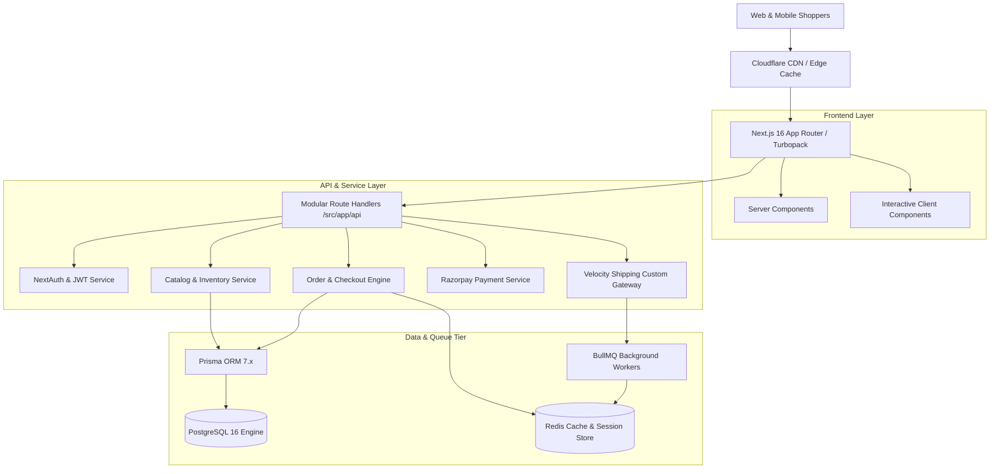

# LEZIVA — Architecture Document 01: Project Overview

## 1. Executive Summary
**LEZIVA** is an original, premium, production-oriented fashion e-commerce atelier platform engineered specifically for luxury ethnic and contemporary women's apparel. The platform caters to discerning clientele seeking bespoke sarees (Banarasi, Kanjivaram, Organza, Chanderi), bridal lehengas, fusion dresses, luxury kurtis, and designer ethnic silhouettes.

Unlike conventional off-the-shelf templates, LEZIVA is designed as a high-performance, editorial digital flagship—combining the warmth of Indian textile heritage with contemporary digital minimalism and state-of-the-art enterprise engineering.

---

## 2. Brand Identity & Design Ethos

### 2.1 Brand Name & Essence
- **Brand**: **LEZIVA**
- **Tagline**: Haute Couture & Contemporary Ethnic Atelier
- **Heritage Anchor**: Rooted in artisanal weaving centers (Surat, Varanasi, Kanchipuram, Chanderi), translated into a global luxury shopping experience.

### 2.2 Official Color System
The visual language strictly adheres to the official brand trio:
1. **Warm Ivory (`#EAE6DE`)**: The foundational canvas tone. Evokes untreated raw silk, ivory tussar yarn, and tranquil atelier gallery walls. Provides warmth and luxury without the harshness of pure white.
2. **Deep Editorial Blue (`#226192`)**: The authoritative structural hue. Used for commanding typographic hierarchies, brand badges, and stately interaction elements.
3. **Coral Orange (`#EF8557`)**: The vibrant accent energy. Inspired by saffron marigolds, festive sunset threads, and zardozi accents; utilized for primary calls-to-action, status pills, and celebratory micro-interactions.

### 2.3 Visual Standards
- High-contrast serif headlines paired with ultra-clean modern geometric sans-serif for prices, metadata, and legibility.
- Strict aspect ratio preservation for official brand logos (`public/brand/leziva-logo.svg` and `public/brand/leziva-symbol.svg`).
- Zero generic placeholder imagery; high-fidelity product photography with multi-angle zoom and fabric drape previews.

---

## 3. High-Level System Architecture

---

## 4. Key Business Objectives
1. **Sub-second Navigation & Core Web Vitals**: Instantaneous catalog browsing, image optimization via Next.js Turbopack, and partial prefetching.
2. **Deterministic Inventory & Zero Overselling**: Transactional row-level isolation during concurrent flash sale checkouts.
3. **Automated End-to-End Fulfillment**: Real-time pincode serviceability check, automated AWB generation, automated label creation, and tracking callbacks via Velocity Shipping integration.
4. **Resilient Payment Handling**: Strict webhook idempotency for Razorpay with automated payment verification, order reconciliation, and instantaneous status transitions.
5. **Mobile-First Luxury Commerce**: Seamless 1-thumb checkout, bottom-sheet drawers, and frictionless UPI payments.
