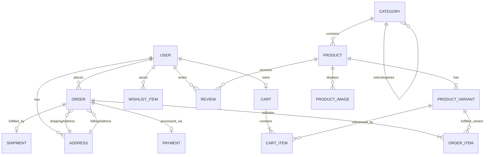

# LEZIVA — Architecture Document 04: Database Architecture Plan

## 1. Relational Database Overview
LEZIVA utilizes **PostgreSQL 16** managed via **Prisma ORM 7.x**. PostgreSQL was selected for strict ACID guarantees, atomic transactions during inventory reservations, native JSONB support for webhook payloads and courier tracking histories, and comprehensive indexing mechanisms.

---

## 2. Entity-Relationship (ER) Diagram



---

## 3. Data Dictionary & Key Schemas

### 3.1 Users & Authentication
- `User`: Primary identity table storing email, verified timestamp, password hash (Argon2 / bcrypt), and role (`CUSTOMER`, `ADMIN`, `CATALOG_MANAGER`, `SUPPORT`).
- `Address`: Multi-address support (Home, Office). Pincode indexed for rapid logistics serviceability checks.

### 3.2 Catalog & Inventory
- `Category`: Self-referential hierarchical tree (`parentId` referencing `Category.id`). Slugs are unique and indexed.
- `Product`: Base apparel parent containing title, SEO slug, description, fabric details, care instructions, and active flags.
- `ProductVariant`: The fundamental SKU-level atomic unit. Stores size, color, exact price, compare price, cost price, and physical dimensions (weight in grams, length, width, height in cm for courier calculations).

### 3.3 Orders & Fulfillment
- `Order`: Central financial record with immutable order numbers (e.g. `LZV-2026-10001`), payment status, and snapshot prices.
- `OrderItem`: Immutable record of variant snapshot at the exact moment of order placement.
- `Payment`: Financial ledger storing Razorpay transaction IDs, capture signatures, currency, and raw webhook payloads for auditing.
- `Shipment`: Logistics record tracking Velocity Shipping AWB numbers, label URLs, manifests, and full tracking timelines.

---

## 4. Indexing Strategy & Performance Optimization

To maintain sub-50ms query times at scale, the following indices are configured:

| Model | Index Target | Index Type | Rationale |
| :--- | :--- | :--- | :--- |
| `User` | `email` | UNIQUE B-Tree | Instant authentication lookup |
| `User` | `role` | B-Tree | Admin authorization filtering |
| `Product` | `slug` | UNIQUE B-Tree | Fast SEO storefront routing |
| `Product` | `[isActive, isFeatured]` | Composite B-Tree | Instant homepage curated carousel queries |
| `Product` | `categoryId` | B-Tree | Category listing page queries |
| `ProductVariant` | `sku` | UNIQUE B-Tree | Barcode & inventory scanning |
| `ProductVariant` | `[productId, isActive]`| Composite B-Tree | Fetching active variants for a PDP |
| `Order` | `orderNumber` | UNIQUE B-Tree | Customer tracking and support lookup |
| `Order` | `[userId, createdAt]` | Composite B-Tree | Customer order history paginated queries |
| `Shipment` | `awbNumber` | UNIQUE B-Tree | Webhook callback reconciliation by AWB |

---

## 5. Concurrency & Inventory Protection (Preventing Overselling)

During high-demand sales, multiple users may attempt to buy the last unit of a saree simultaneously. LEZIVA implements **Transactional Row-Level Decrement**:

```sql
-- Atomic stock deduction with condition
UPDATE "ProductVariant"
SET "inventoryQuantity" = "inventoryQuantity" - $quantity,
    "updatedAt" = NOW()
WHERE "id" = $variantId AND "inventoryQuantity" >= $quantity;
```

In Prisma, this is executed inside an interactive transaction (`prisma.$transaction`). If the affected row count is 0, the transaction immediately rolls back and throws an `Out of Stock` domain exception.

---

## 6. Migration & Seed Workflow
1. Development migrations: `npx prisma migrate dev --name <migration_name>`
2. Production migrations: `npx prisma migrate deploy`
3. Client re-generation: `npm run db:generate`
4. Seeding: `npm run db:seed` (idempotent upserts)
