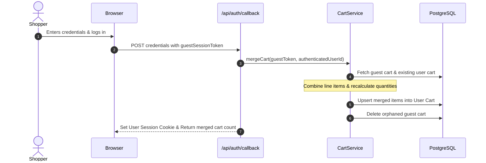

# LEZIVA — Architecture Document 06: Authentication & Authorization Plan

## 1. Authentication Strategy

LEZIVA implements a hybrid, secure authentication architecture supporting:
1. **Authenticated Shoppers**: Email + password or OTP/Social logins via NextAuth / JWT.
2. **Guest Shoppers**: Cryptographically secure guest session tokens (`HttpOnly` cookies) allowing immediate frictionless cart building and checkout without upfront registration.
3. **Staff & Administrators**: High-security multi-role credentials with strict role-based access control (RBAC).

---

## 2. Role-Based Access Control (RBAC) Matrix

| Role | Permissions & Access Scope |
| :--- | :--- |
| `CUSTOMER` | View catalog, manage personal cart, wishlist, profile, place orders, view personal order history and tracking. |
| `CATALOG_MANAGER` | Create, update, publish products, manage variants, upload images, manage categories and collections. Cannot view financials or modify user accounts. |
| `SUPPORT` | View customer orders, resend tracking links, process customer return requests, initiate order cancellations. |
| `ADMIN` | Unrestricted super-user access: financial metrics, profit margins, coupon management, user role assignments, system settings, database backups. |

---

## 3. Session Management & Cookie Security

All session identifiers and JWT tokens are stored strictly in browser cookies with hardened flags:
- `HttpOnly`: Prevents client-side JavaScript access (mitigating XSS theft).
- `Secure`: Transmitted solely over HTTPS in production.
- `SameSite=Lax`: Mitigates Cross-Site Request Forgery (CSRF).
- `Path=/`: Uniform access across storefront routes.

---

## 4. Guest-to-User Cart Merging Flow

When an anonymous user adds items to their guest cart and subsequently registers or logs in:

