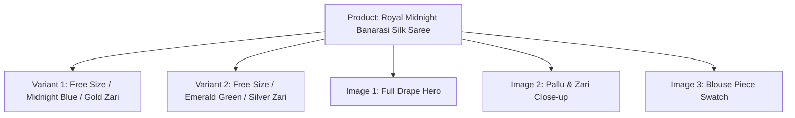
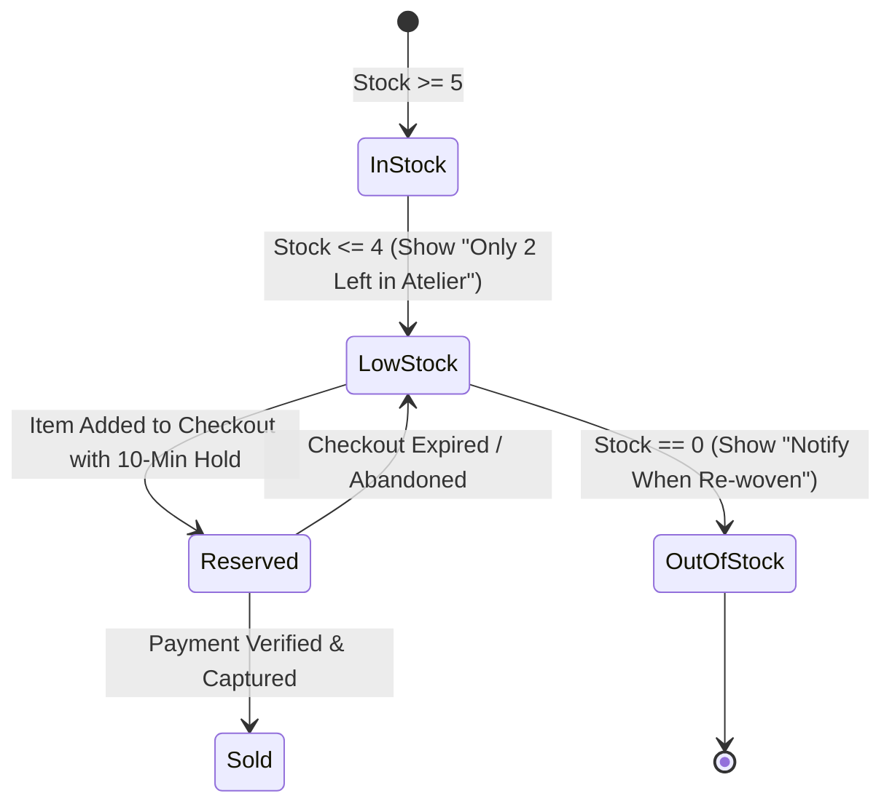

# LEZIVA — Architecture Document 07: Product & Inventory Data Model

## 1. Fashion Catalog Philosophy
High-end ethnic fashion demands structured dimensional data far beyond generic commodities. A single Banarasi saree or designer lehenga possesses weave origin, zari composition (pure gold/silver or tested metallic thread), drape length, blouse fabric unstitched details, and distinct volumetric package dimensions for shipping calculation.

---

## 2. Parent-Child SKU Hierarchy

---

## 3. Detailed Attribute Specifications

### 3.1 Sizing Specification (`Size` Enum)
- `FREE_SIZE`: Standard 5.5m or 6.3m sarees (including 0.8m running blouse piece).
- Standard Apparel: `XS`, `S`, `M`, `L`, `XL`, `XXL` for kurtis, tailored anarkalis, and dresses.
- `CUSTOM`: Bespoke bridal couture made-to-measure with client measurements submitted during checkout.

### 3.2 Fabric & Heritage Metadata
- `fabricComposition`: E.g., "100% Katan Silk", "Pure Chanderi Cotton Silk", "Georgette with Organza Panels".
- `weaveType`: E.g., "Kadwa Weave", "Jangla Pattern", "Meenakari Zari".
- `careInstructions`: E.g., "Strictly Dry Clean Only. Store wrapped in pure muslin cloth away from direct sunlight."

### 3.3 Logistics Dimensions (Mandatory for Velocity Shipping API)
Every variant includes physical shipping parameters:
- `weightGrams`: E.g., `850` (Heavy bridal sarees can weigh 1200g - 2500g).
- `dimensionsCm`: Box packaging dimensions `[length, width, height]` (e.g. `35cm x 28cm x 6cm`).
These parameters feed directly into the Velocity Shipping API calculation engine.

---

## 4. Inventory Reservation & Stock States

### 4.1 Stock Hold Mechanism (10-Minute Checkout Lock)
1. When a shopper enters payment verification, a Redis key `stock_hold:{variantId}:{orderId}` is established with a TTL of 600 seconds (10 minutes).
2. Available stock is calculated as: `Available = DB_Stock - Active_Redis_Holds`.
3. If payment succeeds, DB stock is permanently decremented and Redis hold cleared.
4. If payment fails or times out, the Redis key expires automatically, releasing inventory back to the storefront.
