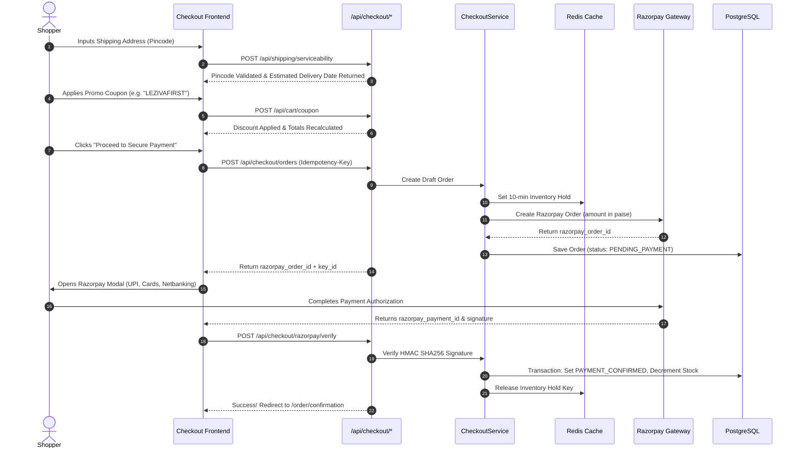
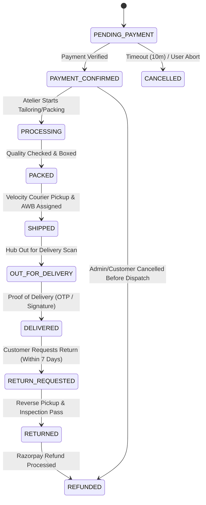

# LEZIVA — Architecture Document 08: Checkout & Order Lifecycle

## 1. Checkout Lifecycle Flow

The checkout journey is designed for high conversion, minimal form friction, and guaranteed transactional integrity.

---

## 2. Order State Machine

---

## 3. Idempotency Guarantees
To prevent duplicate orders caused by network timeouts or repeated button clicks:
1. Every order creation request requires an `Idempotency-Key` header (UUID v4 generated by the client).
2. The key is cached in Redis with a 120-second TTL.
3. If an identical request arrives while the first is in progress or completed, the cached response is returned immediately without re-executing inventory deduction or creating duplicate gateway charges.
