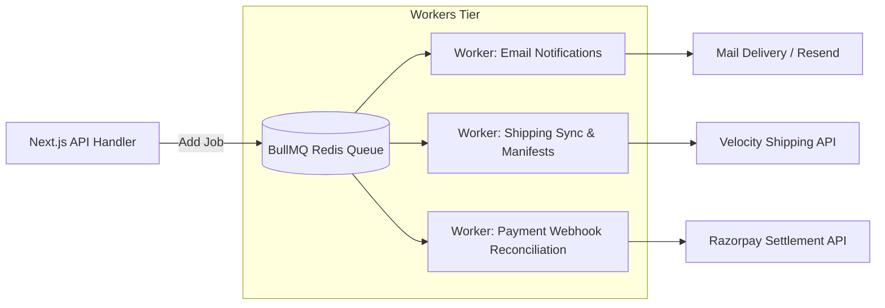

# LEZIVA — Architecture Document 11: Redis Caching & Background Jobs

## 1. Redis Caching Architecture
Redis acts as the high-speed ephemeral data and concurrency coordinator for LEZIVA, running alongside the Node.js application.

---

## 2. Key Space & TTL Strategy

| Key Pattern | Data Type | TTL | Purpose |
| :--- | :--- | :--- | :--- |
| `cache:categories:tree` | String (JSON) | 3600s (1 hr) | Cached category hierarchy to avoid DB joins on header renders |
| `cache:pincode:{code}` | String (JSON) | 86400s (24 hrs) | Cached Velocity Shipping serviceability & courier rates |
| `cart:guest:{token}` | Hash | 604800s (7 days) | High-speed guest shopping cart storage |
| `stock_hold:{variantId}:{orderId}` | String | 600s (10 min) | Temporary inventory hold during Razorpay checkout |
| `ratelimit:{ip}:{endpoint}` | Integer | 60s (1 min) | API rate limiting sliding window counter |
| `idempotency:{uuid}` | String | 120s (2 min) | Idempotent duplicate request suppression |

---

## 3. Background Job Queues (BullMQ)

LEZIVA offloads non-blocking asynchronous workloads to **BullMQ** running on Redis:

### 3.1 Job Queue Definitions
1. **`email-queue`**:
   - Order placed notification (to customer and atelier).
   - Shipping notification with tracking link & AWB.
   - Return confirmation & refund updates.
2. **`shipping-queue`**:
   - Automated pickup scheduling with Velocity.
   - Daily periodic tracking status sync for all in-transit AWBs.
3. **`payment-reconciliation-queue`**:
   - Runs every 15 minutes to verify any orders remaining in `PENDING_PAYMENT` past their threshold against the Razorpay Payments API to capture delayed webhooks.
