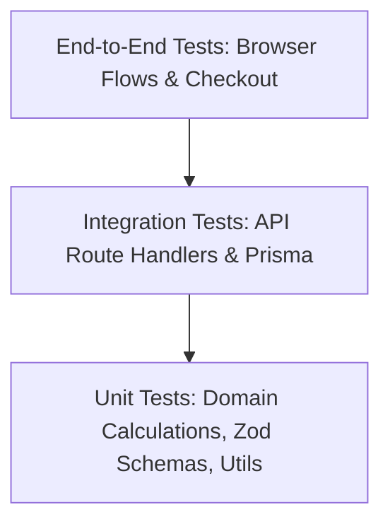

# LEZIVA — Architecture Document 13: Testing Strategy

## 1. Testing Pyramid & Automation Framework

LEZIVA implements a three-tier automated verification hierarchy:

---

## 2. Test Execution Tooling

1. **Test Runner**: Node.js 24 Native Test Runner (`node --test`) with `tsx` TypeScript loader.
   - Command: `npm test`
   - Benefits: Instant cold-boot startup (<50ms), zero peer dependency conflicts, native support for `describe`, `it`, `assert`, and async hooks.
2. **Type Checking**: Strict TypeScript validation (`npx tsc --noEmit`).
3. **Linting**: ESLint 9 with Next.js core web vitals and strict TypeScript rules (`npm run lint`).
4. **Build Verification**: Turbopack production compilation test (`npm run build`).

---

## 3. Test Suites by Phase

| Phase | Scope | Primary Tests |
| :--- | :--- | :--- |
| **Phase 0** | Foundation | Environment validation, error hierarchy, design token contracts. |
| **Phase 1** | Database & Backend | Prisma schema constraints, transactional stock deductions, seed consistency. |
| **Phase 2** | UI & Storefront | Component rendering, accessibility attributes (ARIA), responsive breakpoints. |
| **Phase 3** | Catalog & Search | Product filtering, variant matrix lookups, cart persistence calculations. |
| **Phase 4** | Checkout & Razorpay | Discount coupon math, signature verification, order state transitions. |
| **Phase 5** | Velocity Shipping | Pincode serviceability mapper, label generation adapter, webhook payloads. |
| **Phase 6** | Admin Dashboard | Role-based permission guards, inventory updates, tracking dispatch. |

---

## 4. Third-Party Service Mocking Policy
Under no circumstances are live third-party financial or shipping APIs invoked in unit or integration tests. Dedicated mock harnesses in `src/tests/mocks/` simulate:
- Razorpay order creation and webhook events.
- Velocity Shipping pincode responses and AWB allocation.
