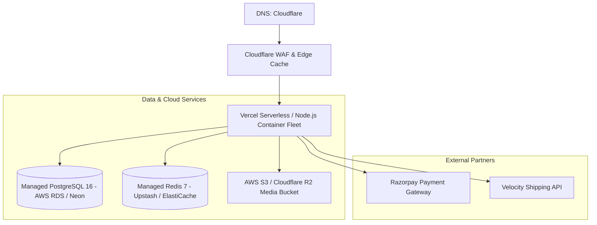

# LEZIVA — Architecture Document 14: Deployment Architecture

## 1. Production Deployment Topology

---

## 2. CI/CD Pipeline Stages

Every deployment to staging or production triggers the following automated pipeline:

1. **Lint & Static Analysis**: `npm run lint` ensures code cleanliness and adherence to standards.
2. **Type Verification**: `npx tsc --noEmit` validates strict TypeScript compilation.
3. **Automated Test Suite**: `npm test` executes all unit and integration assertions.
4. **Prisma Client Generation**: `npm run db:generate` verifies schema integrity.
5. **Production Build**: `npm run build` compiles frontend assets and server routes with Next.js Turbopack.
6. **Database Migration**: `npx prisma migrate deploy` applies pending schema migrations to PostgreSQL.
7. **Smoke Verification**: Automated health probe hits `/api/health` checking database and cache readiness before traffic routing.

---

## 3. High Availability & Scalability Parameters
- **Zero-Downtime Deployments**: Blue-green routing with atomic DNS shift.
- **Auto-Scaling**: Horizontal pod or serverless instance scaling based on concurrent traffic surges during festive collections.
- **Media Optimization**: Images served via Next.js Image Optimization and cached at edge CDN PoPs in WebP/AVIF formats with responsive `srcset` delivery.
